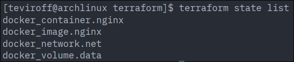
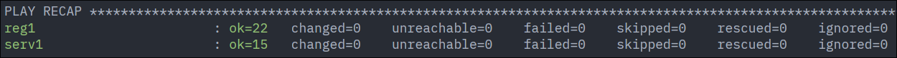
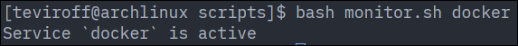
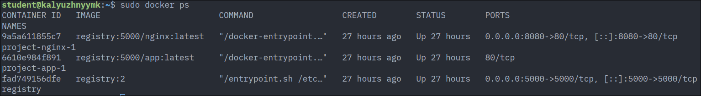
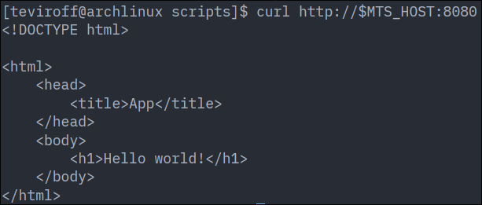

## Terraform

Running `terraform/main.tf` is identical to any other Terraform script:

```bash
# Change directory to `terraform`
cd terraform

# Pull provider and create lockfile
terraform init

# See planned terraform actions
terraform plan

# Apply terraform actions (create container with Nginx)
terraform apply
```

After `terraform apply` you will have Docker container named `nginx` running on your machine
serving static HTML page on port `18080`.

## Ansible

First, you need to initialize `ansible/inventory.ini` according to following schema:

```ini
[registries]
# ...

[servers]
# ...

[servers:vars]
registry=<ansible_host from registries>
```

After that, perform ordinary Ansible commands:

```bash
# Change directory to `ansible`
cd ansible

# Run Ansible playbook
ansible-playbook -i inventory.ini deploy.yml
```

This playbook will start Docker registry hosting application containers on each host in `registries`.
This design allows to transparently track images, that are being ran on `servers`, and saves 
resources by not compiling application containers on each server in `servers`. Current design 
doesn't benefit from multiple `registries` being specified, but this can be impoved in the future.

## Screenshots

Result of `terraform state list`:



Result of `deploy.yml` Ansible playbook:



Result of `monitor.sh` script:



Result of `docker ps` on Ansible deploy target:



Result of `curl` on Ansible deploy target:


